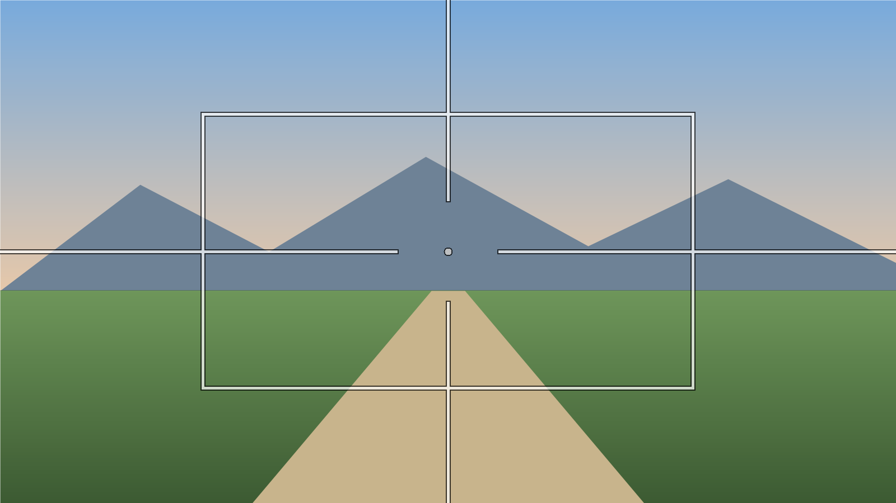

# Comfort Overlay

A tiny Windows overlay that helps with **simulation / motion sickness** in games that don't have their own comfort settings.

It draws a fixed frame box, crosshair lines coming in from the screen edges, and a center dot on top of whatever game you're playing. These fixed reference points give your eyes something stable while the camera moves. They're inspired by the comfort overlay in *Big Walk*. Clicks pass straight through, so the overlay never gets in the way.



## Download

1. **[Download ComfortOverlay.exe](https://github.com/ddswb2/comfort-overlay/releases/latest/download/ComfortOverlay.exe)** (or browse the [Releases](https://github.com/ddswb2/comfort-overlay/releases) page).
2. Double-click it. A crosshair icon appears in the system tray.

That's it. There's nothing to install, it's a single 23 KB file, and it runs on Windows 10 and 11.

> **"Windows protected your PC"?** The exe isn't code-signed, so Windows warns the first time you run a downloaded copy. Click **More info → Run anyway**. If you'd rather not trust a binary, [build it yourself](#build-from-source) in a few seconds.

## Important: use borderless or windowed mode

Windows can't draw anything over a game in **exclusive fullscreen**. In the game's display settings, choose **Borderless**, **Windowed fullscreen**, or **Windowed**.

## Controls

All hotkeys are **Ctrl + Alt + key** and work while the game is focused.

| Key | Action |
|---|---|
| `O` | Show / hide the overlay |
| `B` | Frame box on / off |
| `L` | Edge lines on / off |
| `D` | Center dot on / off |
| `,` `.` | Thinner / thicker lines |
| `-` `=` | More / less transparent |
| `[` `]` | Smaller / bigger box |
| `K` | Cycle color (white, yellow, cyan, green, pink) |
| `M` | Move to the next monitor |

Right-click the **tray icon** for every setting: opacity, box size, line thickness, the gap in the middle, color, monitor, reset to defaults, and **Exit**.

Settings are saved automatically to `%APPDATA%\ComfortOverlay\settings.ini`.

### Start with Windows

Press `Win + R`, type `shell:startup`, and put a shortcut to `ComfortOverlay.exe` in the folder that opens.

## Anti-cheat

The overlay is an ordinary always-on-top window. It never touches the game's process or memory, which is how crosshair overlay tools usually work. Still, a few strict competitive anti-cheat systems dislike overlays of any kind. If you're worried, close it before playing those games.

## Build from source

You don't need Visual Studio. Windows already includes the C# compiler that's part of .NET Framework.

```bat
git clone https://github.com/ddswb2/comfort-overlay.git
cd comfort-overlay
source\build.cmd
```

This produces `Comfort Overlay.exe` in the repo root. All the code is in [`source/ComfortOverlay.cs`](source/ComfortOverlay.cs).

## License

[MIT](LICENSE)
